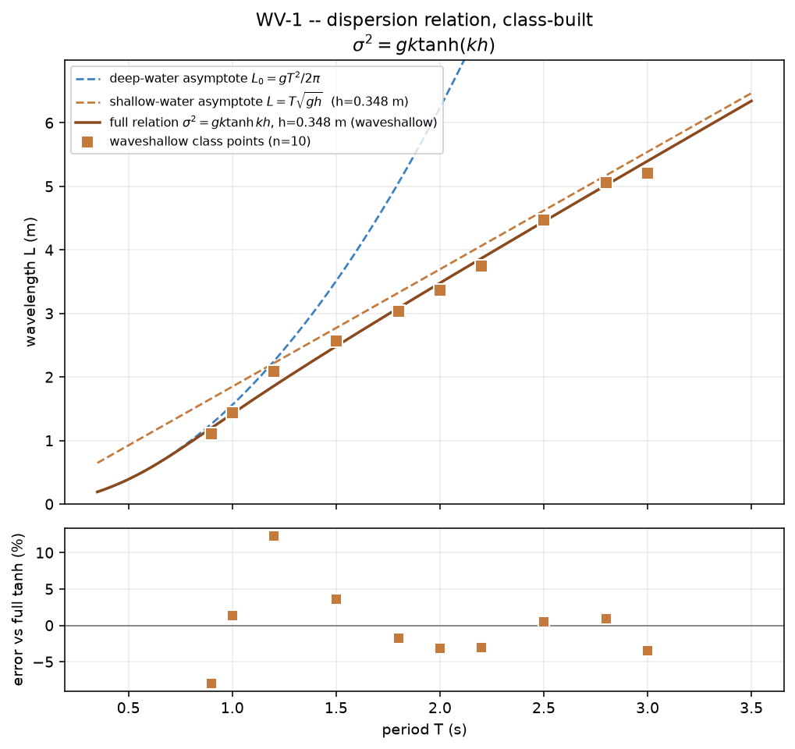

# WV-1 · Dispersion, one period each

## Lecturer notes

A quick in-class exercise, 15 minutes, that draws the dispersion relation
from a class of single measurements. Each student runs the shallow flume at
their own period, times three waves between two depth gauges (two metres
apart for most periods, less for the shortest), keeps the middle time and
turns it into a wavelength. Pooled
on one plot of L against T, the short periods sit near the deep-water line
L₀ = gT²/2π, the long ones approach the shallow-water line L = T√(gh), and
the ones between sag off both onto the full relation σ² = gk·tanh(kh): the
class has drawn it without anyone solving a transcendental equation by
hand.

Students submit **T, Δt and L**; the class pools them on L against T with
the full relation and both asymptotes.

**Open it:** press **E** in the [app](../../../../)
and pick **WV-1**, or use the direct link
[`?ex=WV-1`](../../../../?ex=WV-1).
How to run any exercise: see the [teaching pack index](../../INDEX.md#running-an-exercise).
It runs on the `waveshallow` scene; the card sets everything up.

## The flume

`waveshallow` is a 12 m flume per metre width: a flat bed at z = 0.247 m,
still water h = 0.348 m deep, a piston paddle at x = 0.30 m and a 1 : 20
beach from x = 4.0 m. Medium gives Δx = 11.2 mm, 31 cells over the depth.
The card sets Medium, the paddle on, the gauges on Depth and particles off.
The gauges go at **x = 1.0 and 3.0 m** on the flat; at **1.0 and 2.0 m**
for 1.2 s; at **0.6 and 1.0 m** for 0.9 and 1.0 s, whose waves are small
2 m from the paddle (19 mm at 0.9 s). A Depth gauge reads its column's depth whatever
height it is placed at. Each pair is closer than the wavelength, so the
farther gauge's next up-crossing belongs to the same wave (two metres would
not be, at 1.2 s).

One flume covers kh = 1.8 to 0.40: a 0.9 s wave is 5% shorter than L₀ and a
3 s wave 3% short of T√(gh). The deep-water end itself is out of reach: a
0.7 s wave dies within a wavelength of the paddle (at a stroke of 0.015 m it
is 48 mm high at x = 0.4 m and gone by 1.0 m; closure-on value, not
re-measured), and a steeper stroke only makes it break there. The long end stops at 3 s. At 4 and 5 s the wave is 7–9 m
long on a 3.7 m flat, the beach sends part of it back, and runs whose strokes
differed by half a per cent timed it anywhere from 3% short to 10% long (closure-on value, not
re-measured).

The wait is about **30 s**.

## Why not the deep flume any more

The card used to run half the class in `wavedeep` (h = 0.74 m) and read
crest to crest beside the paddle. Re-measured on the current engine, that
flume does not give a clean wavelength at any period:

- **Long periods read long.** For T = 1.2–2.0 s crest to crest is 14–17%
  longer than linear dispersion (15–22% by the phase gradient). Since issue
  #72 the decaying waves drive a mean circulation, forward along the surface
  at up to 0.2 m/s, and the waves ride it; steepness adds to it (halving the
  stroke at 1.5 s halves the excess, to +8%). Before #72 the same rows read
  +2 to +10%. See the engineering notes, "The deep flume's mean circulation".
- **Short periods die at the paddle.** At the old strokes a 0.75–1.05 s wave
  stood 0.20–0.32 m high at x = 0.6 m, steeper than a wave can stand, and
  was gone within 2–6 m. At strokes small enough not to break, crest to
  crest beside the paddle read −9% to +11%, ±15% from frame to frame, and
  timing between two gauges was worse (±25–60%, except at 0.9 s).

The shallow flume has neither problem: timed as the card says, the periods
from 1.5 s up land within about 4% of linear theory. The three shortest
(0.9–1.2 s) are noisier; see the table below.

## The assignment

**d** is the last digit of the student number. The card prints the rule:

| d | 0 | 1 | 2 | 3 | 4 | 5 | 6 | 7 | 8 | 9 |
|---|---|---|---|---|---|---|---|---|---|---|
| **T (s)** | 0.9 | 1.0 | 1.2 | 1.5 | 1.8 | 2.0 | 2.2 | 2.5 | 2.8 | 3.0 |
| **stroke (m)** | 0.025 | 0.030 | 0.030 | 0.035 | 0.045 | 0.060 | 0.060 | 0.060 | 0.080 | 0.10 |

Small strokes on purpose: a wave high enough to be nonlinear travels faster
than linear theory says (B6 measures it), and a short one breaks at the
paddle. These keep every row's wave a few centimetres high at the gauges.

## What the students do

1. Set Period and Amplitude from the digit and press **R**; wait out the
   settle.
2. Place two Gauges (`5`) at z = 0.40 m: at x = 1.0 and 3.0 m; at 1.0 and
   2.0 m for 1.2 s; at 0.6 and 1.0 m for 0.9 and 1.0 s. Let a few waves
   pass, pause, and expand both (⤢).
3. Find one wave crossing the still depth, d = 0.348 m, on the way up on the
   nearer gauge's chart, and the next upward crossing on the farther one's.
   Δt is the time between them. Do the same for the next two waves and keep
   the middle Δt. The wave's speed is c = Δx/Δt (2.0, 1.0 or 0.4 m) and its
   length L = cT. Every row's Δt is shorter than its period, so the next
   up-crossing is the same wave.
4. Submit T, Δt and L.

Three waves because one is not enough: a single wave's Δt can be up to 20%
off, the middle of three about 5% from 1.5 s up. At 0.9–1.2 s the waves are
short and unsteady near the paddle, and the middle of three can still be
10–20% off (table below).

Timing a crossing of the still level rather than a crest: the crests of the
longer waves are flat-topped and hard to place in time; the up-crossing is
the steepest part of the trace.

## Theory

    σ² = gk·tanh(kh),   σ = 2π/T,   k = 2π/L,   c = L/T

Deep water (tanh kh → 1): L₀ = gT²/2π = 1.56 T². Shallow water
(tanh kh → kh): L = T√(gh), the same speed for every period. In between, the
full relation, solved here by Newton's method in `collect_plot.py`.

Worked example, T = 2.0 s: kh = 0.63, L = 3.48 m, c = 1.74 m/s, so the wave
takes Δt = 1.15 s over the two metres between the gauges. The deep-water
formula would give 6.24 m and the shallow-water one 3.70 m.

## Measured answers

Medium, after the 30 s settle, by `rig.js`: the card's two gauges sampled as
the frame loop samples them, Δt the middle of the first three waves' lags,
H the wave height at each gauge. Each row was also run with the stroke 0.5%
either side: a run on another machine is a different run of the same flow,
and the "any three" column is how far the middle of three moved over every
set of three successive waves in all three runs.

| T (s) | stroke (m) | gauges x (m) | kh | H (mm) | Δt (s) | L (m) | L, linear (m) | error | any three | L₀ (m) | T√(gh) (m) |
|---|---|---|---|---|---|---|---|---|---|---|---|
| 0.9 | 0.025 | 0.6 and 1.0 | 1.82 | 59 / 43 | 0.33 | 1.10 | 1.20 | −8% | −8 to +19% | 1.26 | 1.66 |
| 1.0 | 0.030 | 0.6 and 1.0 | 1.54 | 71 / 56 | 0.28 | 1.44 | 1.42 | +1% | −16 to +22% | 1.56 | 1.85 |
| 1.2 | 0.030 | 1.0 and 2.0 | 1.18 | 48 / 38 | 0.58 | 2.09 | 1.86 | +12% | −2 to +12% | 2.25 | 2.22 |
| 1.5 | 0.035 | 1.0 and 3.0 | 0.88 | 54 / 39 | 1.17 | 2.57 | 2.48 | +4% | −3 to +4% | 3.51 | 2.77 |
| 1.8 | 0.045 | 1.0 and 3.0 | 0.71 | 61 / 48 | 1.19 | 3.03 | 3.08 | −2% | −2 to +4% | 5.06 | 3.33 |
| 2.0 | 0.060 | 1.0 and 3.0 | 0.63 | 70 / 50 | 1.19 | 3.37 | 3.48 | −3% | −3 to +1% | 6.25 | 3.70 |
| 2.2 | 0.060 | 1.0 and 3.0 | 0.57 | 70 / 47 | 1.17 | 3.75 | 3.87 | −3% | −4 to +1% | 7.56 | 4.06 |
| 2.5 | 0.060 | 1.0 and 3.0 | 0.49 | 60 / 50 | 1.12 | 4.47 | 4.45 | +1% | −5 to 0% | 9.76 | 4.62 |
| 2.8 | 0.080 | 1.0 and 3.0 | 0.44 | 69 / 61 | 1.11 | 5.07 | 5.02 | +1% | −3 to +4% | 12.24 | 5.17 |
| 3.0 | 0.100 | 1.0 and 3.0 | 0.40 | 75 / 69 | 1.15 | 5.21 | 5.40 | −4% | −5 to −2% | 14.05 | 5.54 |

From 1.5 s up every row lands within 4% of linear dispersion, and the middle
of any three waves within 5%. The three short rows do not: the first-three
middle is −8%, +1% and +12% at 0.9, 1.0 and 1.2 s, and the middle of any three
ranges from −16% to +22%, because the lag itself jitters from wave to wave
(0.23–0.34 s at 0.9 s, 0.54–0.72 s at 1.2 s). The median over every wave in
the 12 s record is better (+4%, +1%, +2%), so a class that times more waves
and averages would do well there; the card's three-wave rule does not. A
single wave scatters up to 20% at 0.9–1.2 s. Neither
asymptote holds across the class: the full relation is 5% short of L₀ at
0.9 s and 17% short at 1.2 s, and still 3% short of T√(gh) at 3.0 s.

> **Re-measured Oct 2026** with the mixing-length closure off in the wave
> flumes (ν = 1e-4; mvreeuwijk/hydraulician#2), Windows/D3D11 rather than
> Apple M5/Metal. The closure-on values (ν = 1e-5) the card was designed with
> were: Δt 0.29, 0.28, 0.62, 1.27, 1.18, 1.16, 1.19, 1.15, 1.13, 1.13 s and L
> 1.24, 1.44, 1.95, 2.37, 3.06, 3.45, 3.71, 4.35, 4.95, 5.30 m, every row
> within 5% and the middle of any three within 8%. Re-run here with the
> closure on, 0.9, 1.5 and 3.0 s give L = 1.20, 2.48 and 5.37 m, inside the
> old bands. With it off the long rows (1.5–3.0 s) move by 1–5%, but the short
> ones (0.9–1.2 s) lose the damping that smoothed their trace and scatter
> more; at 2 m from the paddle a 0.9 s wave is still 19 mm and a 1.2 s wave
> 38 mm high.

## Pooling the class

Collect one row per student, `student,digit,T_s,dt_s,L_m` (extra columns
ignored), export the CSV and run:

```bash
python3 collect_plot.py class.csv                 # -> plots/pooled-demo.png
python3 collect_plot.py data/simulated-class.csv  # the shipped dry-run class
```

The script plots L against T with the full relation at h = 0.348 m and both
asymptotes, over a residual panel of each point's error against the full
relation. The dry-run class is the measured table, one row per digit.



## Discussion points

- **Which formula would you use for a 2 s wave here?** Neither asymptote:
  read the error each one makes off the class plot.
- **Why does a long wave not care about its period?** In shallow water every
  period travels at √(gh): ask the class to read c off the long rows.
- **Where does the wave "feel" the bottom?** kh ≈ π is the usual line for
  deep water; find the period where the class's points leave L₀.
- **What does a deeper flume change?** Nothing in the relation — only where
  on it a given period falls. (The pack's deep flume cannot show this cleanly
  at present; see above.)

## Console spot-check

Paste [rig.js](rig.js) into the console and run `await WV1.run(2.0, 0.06)`
for one row: it picks WV-1, sets the period and stroke, presses R, settles,
places the two gauges, records as the frame loop samples them and returns Δt
and L the way the card says, with linear theory beside them.
`await WV1.sweep()` runs every row the card prints.
